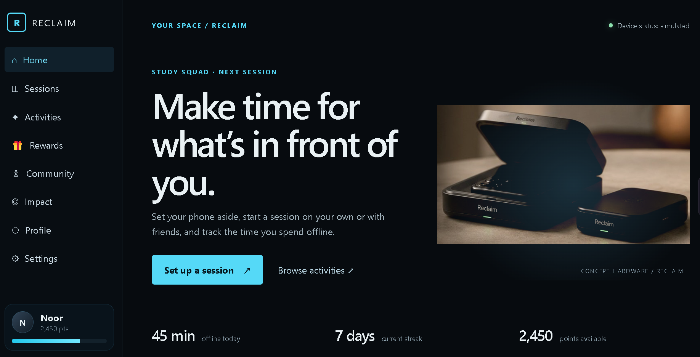
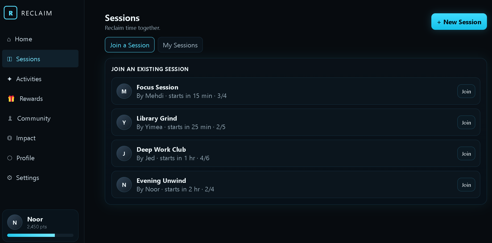
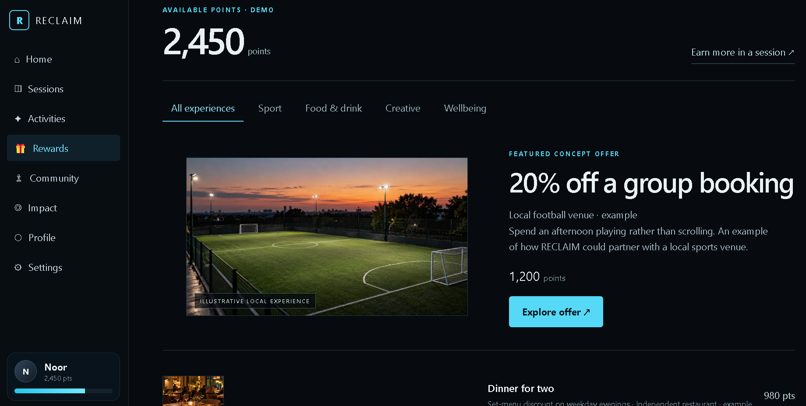

# RECLAIM

### Put it down. Pick life up.

**A physical and digital product concept designed to make screen-free time a shared experience.**

**Best Project Award — KTUR Entrepreneurship Summer School, 2026**

[**Explore the Interactive Prototype ↗**](https://nnoorussabah.github.io/Reclaim/) · [**Watch the Concept Commercial ↗**](./video/) · [**View the Presentation ↗**](./docs/)

---

## Why RECLAIM?

Think about the last time you sat around a table with friends or family. How many times did someone pick up their phone without even thinking about it?

That observation became the starting point for RECLAIM, a team project developed during an entrepreneurship summer school.

We wanted to explore a question:

**What if putting your phone away became something you did together, rather than another habit you had to manage alone?**

Screen-time reminders can tell people to stop scrolling. But they don't necessarily make putting the phone away more appealing, or help people decide what to do instead.

Our idea was to combine a physical action, shared accountability, and positive incentives into one experience.

## Meet RECLAIM

RECLAIM is a proposed system consisting of two connected parts:

**The physical product:** A compact box that holds a smartphone, creating an intentional separation between the user and their device.

**The digital experience:** A companion app that supports individual and group sessions, tracks screen-free time, suggests activities, and introduces a points-based rewards system.

What makes the concept different is that each person has their own box, but the boxes can be physically stacked together.

The idea is simple: **individual commitment becomes a visible group commitment.**

## How It Works

### 01 / Put your phone away

Each person places their smartphone inside their individual RECLAIM box and closes the lid.

The proposed design includes a matte-black housing, rounded edges, a closing mechanism, and a small green status light.

The physical action is intentional. Instead of simply switching to another app or dismissing a reminder, users create distance between themselves and their phones.

### 02 / Stack together

When friends or family members want to spend screen-free time together, they bring their individual boxes together and stack them flat, one on top of another.

Stacking is not just a space-saving feature. It's a visual representation of shared commitment.

Every box represents one person choosing to participate.

RECLAIM can also be used individually, without stacking.

### 03 / Start a session

The companion app represents the digital side of the experience.

Users can explore solo or group sessions, with longer screen-free periods earning more points. Group participation is designed to offer additional incentives.

The original concept also explored shared accountability: if someone ends a group session early, the group's reward could be affected.

The interactive prototype demonstrates these ideas through simulated sessions rather than a connection to functioning physical hardware.

### 04 / Find something to do

We also wanted to address a practical question:

**Once everyone puts their phones away, what happens next?**

RECLAIM includes activity suggestions for spending that time intentionally, whether that's playing a board game, painting, going outdoors, exercising, or exploring something locally.

The aim is to make spending time offline feel worthwhile, rather than restrictive.

### 05 / Turn progress into experiences

The proposed rewards model gives users an additional reason to build consistent habits.

Points earned from screen-free sessions could be exchanged for discounts or experiences offered by participating local businesses.

For example, a group might use its points toward booking a football pitch or trying an activity together.

The business model explored partnerships where participating businesses benefit from customer discovery and engagement.

**These offers and partnerships are conceptual examples, not live commercial arrangements.**

---

## The Digital Prototype

After the summer school, I continued exploring how RECLAIM could work as an interactive digital experience.

The result is **RECLAIM V5**, a browser-based prototype demonstrating the product's proposed interface, features, and user journeys.

The prototype was developed through an iterative, AI-assisted workflow, with particular attention to how the physical product and digital experience fit together.

### 01 — Home: Introducing the experience

The home screen introduces RECLAIM and creates a starting point for exploring the product.

It brings together the physical device concept, session setup, screen-free activity discovery, and example progress indicators.

The design uses a dark interface with electric-blue accents inspired by the proposed product's visual identity.

### 02 — Sessions: Making time together

The Sessions area explores how people could create or join a screen-free session.

Users can interact with a demonstration of individual and group participation, including session progress and illustrative points.

The intention is to make the process straightforward: put the phone away, begin a session, and focus on the activity or people around you.

### 03 — Rewards: Making offline time rewarding

The Rewards area explores how time spent offline could translate into real-world experiences.

It demonstrates point balances, different reward categories, and example offers from potential local partners.

The featured football booking and other offers illustrate how RECLAIM might encourage users to spend more time doing things together.

### Activities and other features

The prototype also includes activity discovery and additional exploratory areas for community, progress, and user settings.

Together, these screens communicate a broader idea: RECLAIM should help people enjoy the time they reclaim, not simply measure how long they avoid their phones.

**[Explore the live RECLAIM V5 prototype →](https://nnoorussabah.github.io/Reclaim/)**

*Note: This is an interactive concept prototype. Device status, session data, points, users, and rewards are simulated for demonstration purposes.*

---

## Physical Product Design

The hardware concept was developed to make the act of putting a phone away feel simple and deliberate.

The proposed box includes a compact form, opening lid, green indicator, and a stackable design that allows several users to combine their individual devices during a group session.

The physical design supports two different experiences: personal screen-free time and shared group sessions.

The illustrations represent a proposed industrial design. Dimensions, electronics, charging, materials, and battery performance have not been validated through manufacturing or hardware testing.

---

## Bringing the Concept to Life

### The concept commercial

To help communicate the experience beyond presentation slides and still images, I created a short AI-assisted concept commercial.

The video visualizes the journey from placing a phone inside RECLAIM to taking part in a shared session and enjoying time with others.

It is a visualization of the intended product experience, rather than footage of manufactured hardware.

**[Watch the RECLAIM commercial](./video/)**

### The original project presentation

The summer school presentation documents the original entrepreneurship idea and the team's approach to developing it.

**[View the project presentation](./docs/)**

---

## The Entrepreneurship Project

RECLAIM began as a collaborative project during the **KTUR Entrepreneurship Summer School in 2026**.

Our work combined problem identification, product ideation, behavioral thinking, market exploration, business model development, and pitching.

We explored not just what a phone-storage product could look like, but why people would use it and how the experience could encourage repeat participation.

The project received the **Best Project Award** at the end of the program.

## My Contribution and Continued Development

My involvement covered technical concept exploration, product visualization, market research, and the preparation of the project pitch and presentation alongside the team.

After the summer school, I independently continued developing the concept into a more tangible portfolio demonstration.

This included:

- Iteratively creating and refining the interactive website prototype through AI-assisted development.
- Exploring the session experience, group incentives, activity suggestions, and conceptual rewards.
- Refining the interface and visual presentation to better communicate the product.
- Producing an AI-assisted video commercial through visual references, prompt iteration, and evaluation of generated footage.
- Bringing the hardware concept, digital prototype, and project documentation together in one GitHub repository.

The purpose of this continued work was to make an entrepreneurship idea easier to experience and evaluate, not to present it as a fully developed commercial product.

---

## What I Took Away

RECLAIM taught me that developing an idea is not only about identifying an interesting problem.

It is also about finding a way to translate that problem into a product experience people can understand.

For this project, the challenge was connecting several different elements: physical product design, behavioral motivation, social participation, digital interaction, and a possible business model.

Continuing to develop the interactive prototype and commercial after the program also gave me an opportunity to experiment with AI-assisted prototyping and visual storytelling.

One of the biggest lessons was that **a concept becomes much easier to communicate when people can see and interact with it**, rather than only reading about it on a slide.

---

## Project Status

**Concept development and interactive prototyping.**

RECLAIM is an entrepreneurship concept, not a commercially available product.

The hardware visuals are design proposals, the companion website is a simulation, and the commercial is AI-generated concept footage. Reward partnerships and business features are illustrative.

The repository is intended to document the idea, our entrepreneurship process, and the subsequent exploration of the digital experience.

---

**RECLAIM — Put it down. Pick life up.**
