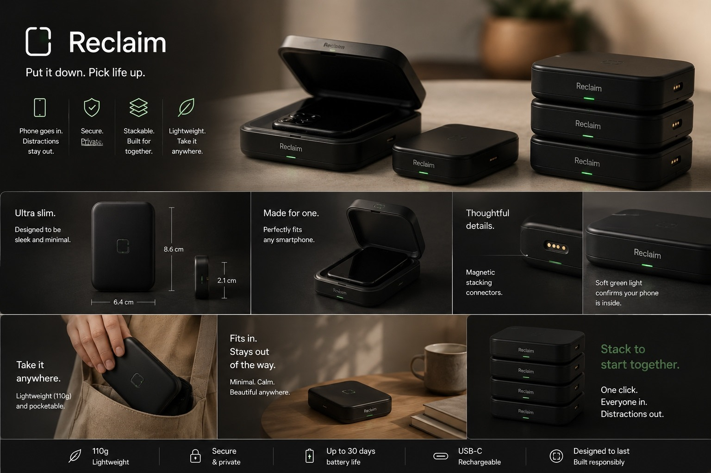

# RECLAIM
### Put it down. Pick life up.

**An award-winning entrepreneurship concept exploring how physical design and technology can encourage more meaningful time away from our screens.**

**RECLAIM** was developed as a team project during the **KTUR Entrepreneurship Summer School 2026**, where it received the **Best Project Award**.

The idea started with a simple observation: even when we're spending time with friends or family, our phones are rarely out of reach.

We wanted to explore a solution that goes beyond screen-time reminders and creates a shared reason to disconnect.

---

## The Concept

RECLAIM combines a physical smartphone docking box with a companion digital experience.

Instead of relying entirely on willpower or app notifications, users physically put their phones away before beginning a screen-free session.

The experience is designed around three ideas:

**Physical commitment** — Placing a phone inside a dedicated box creates an intentional separation from the device.

**Shared accountability** — Individual RECLAIM boxes can be stacked together during group sessions, making the commitment visible and collective.

**Positive reinforcement** — Screen-free sessions earn points, while suggested activities and potential rewards encourage users to make the most of their offline time.

The goal isn't to eliminate technology. It's to help people be more intentional about when they use it.

## How RECLAIM Works

### 01. Dock your phone

Each person places their smartphone inside an individual RECLAIM box.

The proposed hardware uses a minimal matte-black design, a closing lid, and a small status indicator to communicate that the phone has been docked.

### 02. Connect through stacking

For group sessions, participants physically stack their individual boxes together.

This transforms a personal decision into a shared commitment. The physical interaction is a central part of the concept, rather than simply another feature inside an app.

RECLAIM is also designed to work independently for solo sessions.

### 03. Start a screen-free session

The companion app provides a digital experience for starting sessions, tracking progress, and demonstrating how users could earn points for spending time away from their phones.

The concept includes additional incentives for group participation, encouraging friends and families to disconnect together.

### 04. Make the time count

Putting down a phone is only half the challenge. The next question is: *What do we do instead?*

RECLAIM includes activity suggestions for different settings and group sizes, from board games and painting to outdoor activities and shared experiences.

### 05. Earn rewards

The proposed rewards system connects consistent screen-free habits with opportunities to discover local activities and businesses.

Potential rewards include discounts or experiences offered through future partnerships with participating businesses.

These partnerships are part of the proposed business model, not existing commercial arrangements.

---

## Explore the Interactive Prototype

**RECLAIM V5** is a clickable, browser-based prototype developed to demonstrate the digital side of the concept.

The prototype includes:

- **Solo and group sessions:** An interactive demonstration of the proposed session and points experience.
- **Activity discovery:** Suggestions for meaningful screen-free activities, including filters and activity details.
- **Rewards:** A conceptual system for redeeming points toward local experiences.
- **Product experience:** A visual demonstration of how the physical device and digital features fit together.

The prototype was created as a design and exploration tool, not as a production-ready application connected to manufactured hardware.

**[Launch the RECLAIM Interactive Prototype](https://nnoorussabah.github.io/Reclaim/)**

---

## The Product Design

The proposed physical product was designed to be compact, minimal, and easy to incorporate into everyday life.

The key design decision is its **stackable form**: while each box supports individual use, stacking multiple units physically represents a collective decision to be present.

The product illustrations communicate the intended hardware experience. Dimensions, materials, electronics, battery performance, and other specifications remain design proposals rather than validated manufacturing specifications.

---

## Watch the Concept Commercial

A short AI-assisted commercial was created to communicate the RECLAIM experience visually.

The film follows friends putting their phones away, participating in a shared docking ritual, and returning their attention to each other.

It serves as a visualization of the intended experience, rather than footage of a manufactured or commercially available product.

**The commercial video is available in the [`video`](./video) folder.**

---

## Our Approach

RECLAIM was developed through an entrepreneurship-focused process combining problem identification, product ideation, user experience thinking, business model exploration, and pitching.

The project brought together several connected elements:

| Area | What we explored |
|---|---|
| Problem | Digital distraction during social and personal time |
| Physical product | Individual smartphone boxes with a stackable group design |
| Behavioral concept | Commitment, shared accountability, and positive reinforcement |
| Digital experience | Sessions, progress tracking, activities, and rewards |
| Business model | Potential local-business partnerships and reward-based engagement |
| Communication | Product visualization, prototype development, and concept storytelling |

A key challenge was finding a way for the physical product and digital platform to reinforce each other without simply creating another distracting application.

---

## From Idea to Interactive Experience

The initial concept was developed during the summer school as a team entrepreneurship project.

Following the program, the idea was further explored through an interactive website prototype and an AI-assisted concept commercial.

The prototype was built through an iterative, AI-assisted development workflow, with attention to the user journey, interface design, session mechanics, and visual consistency.

The commercial was developed through AI video generation and iterative prompting to explore how the physical product and group experience could be communicated in a short visual narrative.

These extensions were intended to make the original concept easier to experience, demonstrate, and discuss.

---

## Project Recognition

**Best Project Award — KTUR Entrepreneurship Summer School, 2026**

RECLAIM received the program's Best Project Award for the team's entrepreneurship project.

The experience brought together product thinking, collaboration, market exploration, and pitching into a single concept.

**[View the project presentation](./docs/)**

---

## Project Status

**Entrepreneurship concept and interactive demonstration.**

RECLAIM is not currently presented as a manufactured or commercially launched product.

The hardware imagery represents proposed industrial design, the website is an interactive concept prototype, and the commercial illustrates the intended user experience.

The project demonstrates an approach to combining physical design, behavioral thinking, digital prototyping, and entrepreneurship.

---

*RECLAIM — Put it down. Pick life up.*
